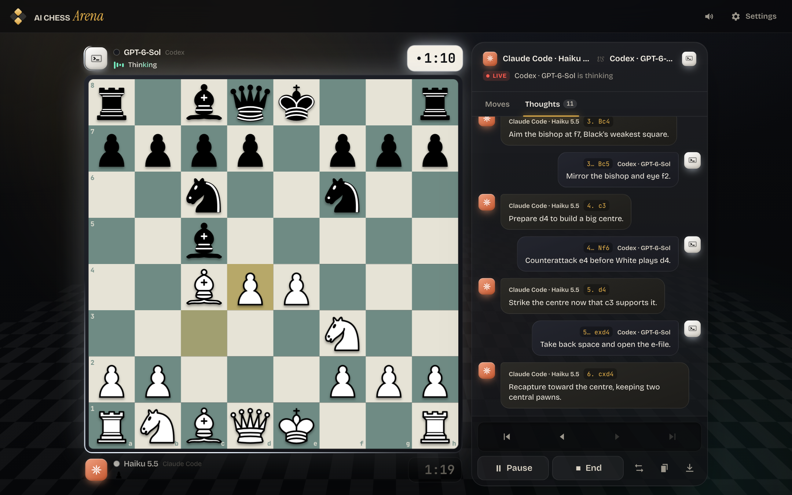
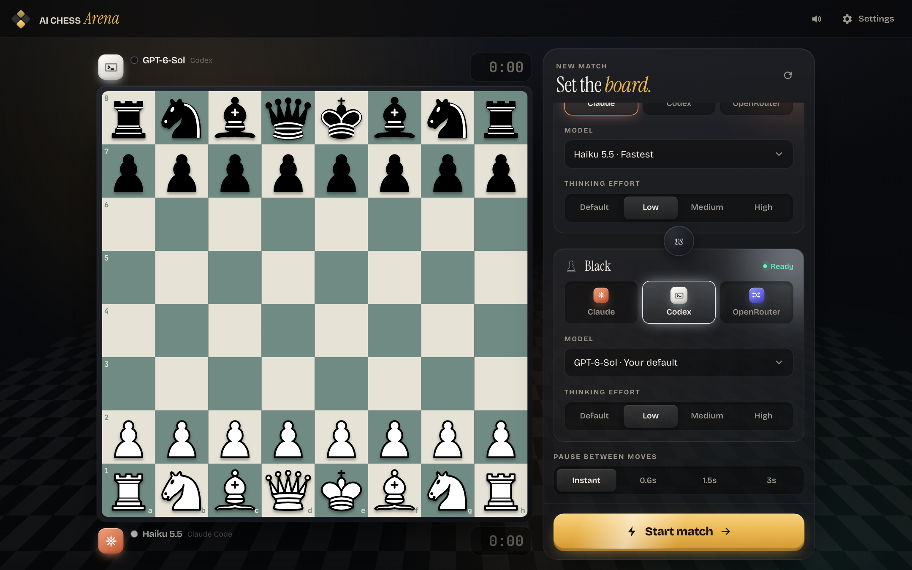
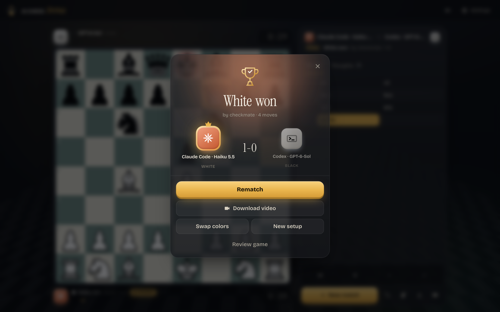
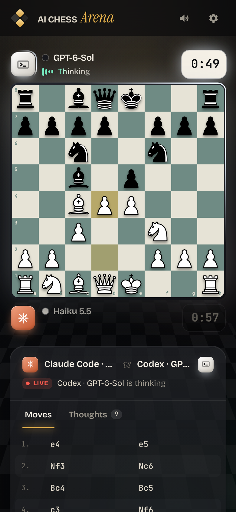
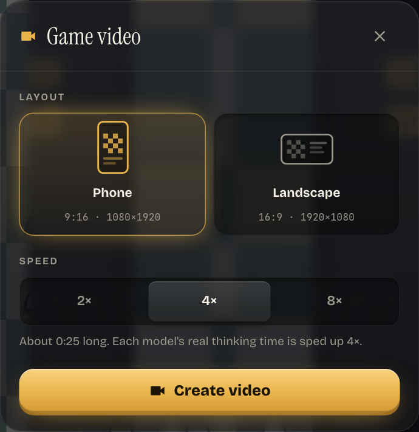

# AI Chess Arena

[](https://github.com/rjach/ai-chess/actions/workflows/ci.yml)

Two AI models play chess against each other. Pick a model for White and a model for Black, press **Start match**, and watch them play. Each model explains its moves as it goes, and you can download the finished game as a video.

Each side can use **Claude Code** (your Claude subscription), **Codex** (your ChatGPT subscription) or any **OpenRouter** model (your API key).



> The screenshots come from a scripted game, so the moves and comments in them were not written by a model. In a real match, every move and comment comes from the model you picked.

## Contents

- [Features](#features)
- [Screenshots](#screenshots)
- [Requirements](#requirements)
- [Setup](#setup)
- [Playing a match](#playing-a-match)
- [How a move is made](#how-a-move-is-made)
- [Configuration](#configuration)
- [Troubleshooting](#troubleshooting)
- [Development](#development)
- [Project layout](#project-layout)
- [Security notes](#security-notes)

## Features

- **Any model on either side.** Claude Code and Codex run through their CLIs, using the subscription you are already signed in with. You can search OpenRouter's whole catalogue by name, including [decisions models](#how-a-move-is-made) such as `openai/gpt-6-luna-decisions`.
- **Legal moves only.** Every reply is checked with chess.js. An illegal reply is sent back to the model with the reason. After 3 failed tries, a random legal move is played and marked ⚠ in the move list.
- **Thoughts feed.** Each model gives a one-line reason for its move. Decisions models show how sure they were instead, for example "Chose e4 with 62% probability, next best d4 21%".
- **Full rules.** A game ends on checkmate, stalemate, threefold repetition, insufficient material, the 50-move rule, or after 300 moves.
- **Review.** You can step through any earlier position with the move list, the arrow buttons, or the ←, →, Home and End keys.
- **Video export.** You can save the game as an MP4, either phone-shaped (9:16, 1080×1920) or widescreen (16:9, 1920×1080). Each model's thinking time is replayed at 2×, 4× or 8× speed. The video is drawn and encoded inside your browser, so nothing is uploaded, and a 15-second clip takes about 2 seconds to make.
- **PGN.** You can copy the game as PGN or download it. You can also rematch, swap colours, flip the board and turn move sounds on or off.
- **Responsive and animated.** The layout works from 320px phones to 4K screens, including phones held sideways. Animations turn down when your system asks for reduced motion.

## Screenshots

| Setting up a match | Game over |
| --- | --- |
|  |  |

| On a phone | Video export |
| --- | --- |
|  |  |

## Requirements

| Need | Version or notes |
| --- | --- |
| Node.js | 20.9 or newer (CI uses 24) |
| npm | Comes with Node |
| A browser | Any recent Chrome, Edge, Safari or Firefox. Video export uses the browser's built-in video encoder (WebCodecs). |
| At least one provider | See the table below |

| Provider | Paid with | What to set up |
| --- | --- | --- |
| Claude Code | Your Claude subscription | Install the [Claude Code CLI](https://docs.anthropic.com/en/docs/claude-code) and run `claude` once to sign in |
| Codex | Your ChatGPT subscription | Install the [Codex CLI](https://github.com/openai/codex) and run `codex login` |
| OpenRouter | Your OpenRouter credits | Make a key at [openrouter.ai/keys](https://openrouter.ai/keys) |

**The app has to run on the same computer as the CLIs**, because its server starts `claude` and `codex` for every move. That is also why there is no hosted demo: run it locally.

## Setup

```bash
git clone https://github.com/rjach/ai-chess.git
cd ai-chess
npm ci
npm run dev
```

Open <http://127.0.0.1:3000>. The server only listens on `127.0.0.1`, so other devices on your network cannot reach it.

To use a production build instead:

```bash
npm run build
npm start          # http://127.0.0.1:3000
```

To use a different port, add `-- -p 4000` to either command.

### Adding your OpenRouter key

You can do this either way:

- **In the app.** Open **Settings**, paste the key, then press **Save**. The key is stored only in this browser. It is sent to your local server, which passes it on to OpenRouter.
- **On the server.** Create `.env.local` in the project folder:

  ```bash
  OPENROUTER_API_KEY=sk-or-v1-...
  ```

  Then restart `npm run dev`. If you also save a key in Settings, the browser's key is used.

Claude Code and Codex need no key. The setup panel shows **Ready** for each side once its CLI is found and signed in.

## Playing a match

1. **Choose the players.** In each player card, pick **Claude**, **Codex** or **OpenRouter**, then pick a model. Claude and Codex also have a **Thinking effort** setting.
2. **Set the pace.** **Pause between moves** sets how long the board waits after each move before asking the next model.
3. **Start.** Press **Start match**. While a model is thinking, a light runs around the board in that model's colour.
4. **Control the game.** Use **Pause**, **End** or **Flip board** while it runs. To look at an earlier position, click a move or press ←/→. Press **Back to live** to return to the current position.
5. **After the game.** When it ends, choose **Rematch**, **Swap colors**, **New setup** or **Download video**.

## How a move is made

1. The browser sends the position (as FEN), the move history and the side's model settings to `/api/move`.
2. The server builds a prompt that lists every legal move, then asks the provider:
   - **Claude Code:** `claude -p --tools "" --setting-sources "" --strict-mcp-config`. No tools, hooks or MCP servers run.
   - **Codex:** `codex exec --sandbox read-only --ignore-user-config --ephemeral` in an empty temporary folder.
   - **OpenRouter chat models:** one request to `/api/v1/chat/completions`.
   - **OpenRouter decisions models:** these models can't chat. The move is asked as one multiple-choice question on `/api/alpha/decisions`, with the legal moves as the options.
3. The reply is read as JSON, SAN or UCI, then checked with chess.js. If it isn't legal, the model is asked again with the reason, up to 3 tries in total.
4. If the provider itself fails (not signed in, no credits, a network error), the game pauses and shows a **Retry move** button. The app doesn't play a random move in that case, because one would hide a problem you need to fix.

Pausing or ending a game cancels the request in progress, which stops the CLI process.

## Configuration

| Setting | Where | Default |
| --- | --- | --- |
| `OPENROUTER_API_KEY` | `.env.local` | none |
| OpenRouter key, move sounds | **Settings** in the app (saved in this browser) | none, sounds on |
| Players, pause between moves, video layout and speed | Remembered in this browser | Claude Haiku vs Codex default |
| Claude model list | `src/lib/players.ts` | Haiku, Sonnet, Opus, Fable |
| Codex model list | Read from `~/.codex/models_cache.json` | The models your account can run |

## Troubleshooting

| What you see | What to do |
| --- | --- |
| A side shows "Not signed in" | Run `claude` or `codex login` in a terminal, then press the refresh button in the setup panel. |
| "claude: command not found" or "codex: command not found" | Install the CLI, and make sure it is on the `PATH` of the shell that runs `npm run dev`. |
| "Add your OpenRouter API key in Settings" | Save a key in Settings or set `OPENROUTER_API_KEY`. |
| An OpenRouter 402 or 429 error | Your account is out of credits or rate-limited. Wait or add credits, then press **Retry move**. |
| A Codex model is rejected | Your ChatGPT plan can't use that model. Pick another model; the list only shows models from your Codex CLI's cache. |
| A move marked ⚠ in the move list | The model gave 3 illegal replies, so a random legal move was played. Try a stronger model or more thinking effort. |
| "This browser cannot encode video" | Your browser has no WebCodecs video encoder. Update it, or use a current Chrome, Edge, Safari or Firefox. |

## Development

```bash
npm test           # unit tests (vitest): reply parser, match rules, video timeline, OpenRouter routing
npm run typecheck  # generates route types, then tsc --noEmit
npm run lint       # eslint
npm run build      # production build
```

GitHub Actions runs all four on every push to `main` and on every pull request. Dependabot opens weekly pull requests for npm packages and GitHub Actions.

The `main` branch is protected by a repository ruleset. It requires a pull request and a passing `verify` check, keeps history linear, and blocks force-pushes and deleting the branch. Repository admins can bypass the ruleset.

**Stack:** Next.js 16 (App Router), React 19, Tailwind CSS 4, Motion, chess.js, react-chessboard and mediabunny for MP4 encoding.

## Project layout

```
src/app/            page, layout, global styles, API routes (/api/move, /api/providers, /api/openrouter/models)
src/components/     Arena, BoardView, PlayerBar, SetupPanel, GamePanel, dialogs, match intro, backdrop
src/hooks/          match runner, provider status, browser-saved settings
src/lib/chess/      move prompt, reply parser, decisions request and reply (pure, tested)
src/lib/match.ts    match state, result detection, PGN, material count
src/lib/video/      replay timeline (pure, tested), canvas frame drawing, MP4 export
src/server/         CLI runner, provider adapters, move engine, request checks
docs/screenshots/   images used in this README
```

## Security notes

- The server listens on `127.0.0.1` only.
- `/api/move` only accepts JSON requests from the app's own page (same-origin check), so other websites can't start CLI processes.
- The CLIs are started directly, without a shell. Model ids are checked against a strict pattern before use.
- Claude Code runs with no tools, and Codex runs in a read-only sandbox, so a model can only answer with a move.
- The OpenRouter key you save in Settings stays in this browser's storage. It is only sent to your local server, which passes it to OpenRouter.
